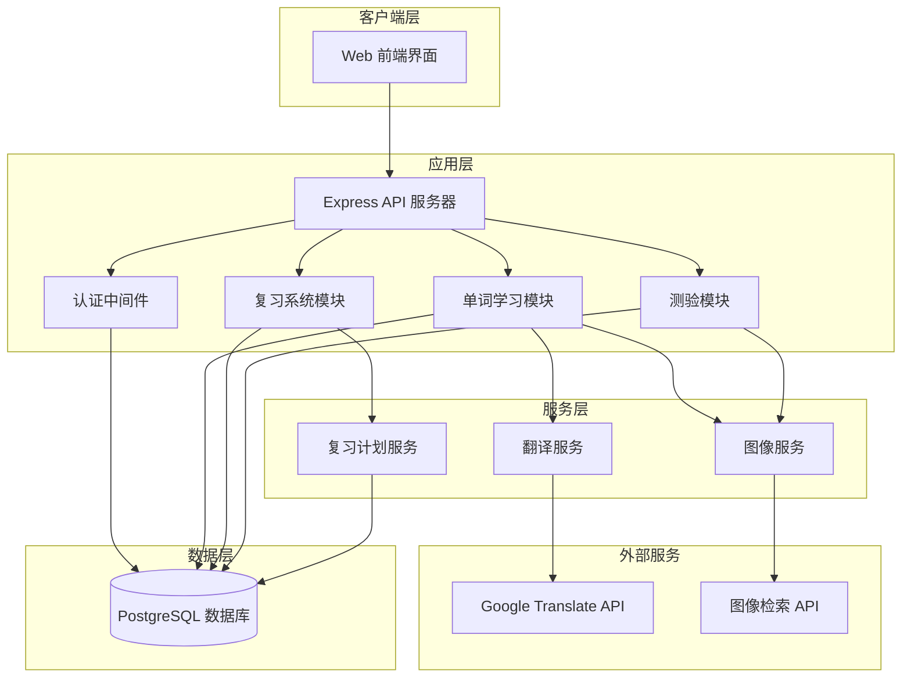
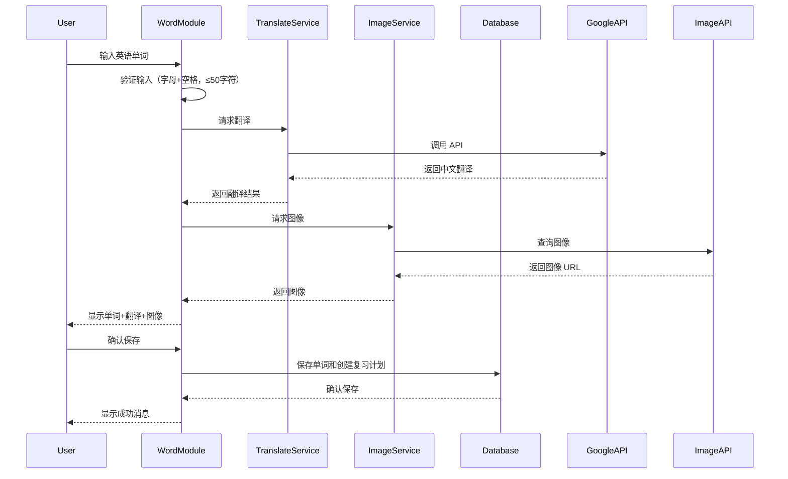
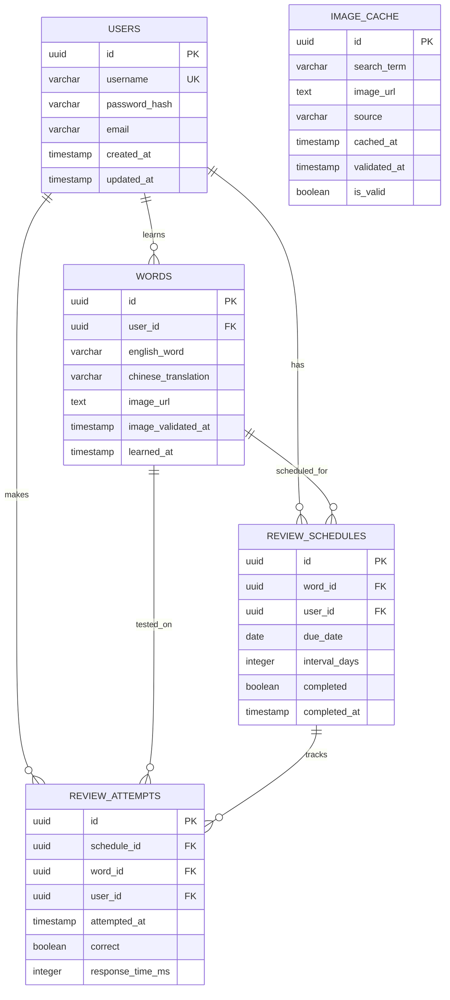

# 技术设计文档

## 概述

儿童英语学习平台是一个基于 Node.js 的 Web 应用程序，旨在通过交互式、游戏化的方式帮助儿童学习英语词汇。系统的核心功能包括：

- **用户认证系统**：安全的登录和会话管理
- **单词学习流程**：输入英语单词 → Google Translate API 翻译 → 图像检索 → 确认保存
- **智能复习系统**：基于艾宾浩斯遗忘曲线的间隔重复算法（1天、3天、7天、15天、30天）
- **图像测验**：展示1个单词和4个打乱的图像选项，通过视觉关联强化记忆
- **数据持久化**：用户数据、单词库、学习记录和复习计划的完整存储

该平台采用前后端分离架构，后端使用 Node.js + Express，数据库使用 PostgreSQL，集成 Google Translate API 和图像检索服务。

### 设计目标

1. **教育有效性**：通过科学的间隔重复算法最大化学习效果
2. **用户体验**：简洁直观的界面，适合儿童使用
3. **可靠性**：稳定的外部 API 集成和错误处理
4. **安全性**：保护用户数据和防止恶意输入
5. **可扩展性**：支持未来添加更多语言和学习模式

## 架构

### 系统架构图



### 架构层次说明

#### 1. 客户端层
- **Web 前端界面**：使用现代前端框架（建议 React 或 Vue.js）构建的单页应用
- 负责用户交互、表单验证、状态管理和 API 调用

#### 2. 应用层（Node.js + Express）
- **Express API 服务器**：RESTful API 端点，处理所有客户端请求
- **认证中间件**：JWT 令牌验证，会话管理
- **单词学习模块**：协调翻译、图像检索和数据存储
- **复习系统模块**：管理复习计划和单词选择逻辑
- **测验模块**：生成测验题目和验证答案

#### 3. 服务层
- **翻译服务**：封装 Google Translate API 调用，处理错误和重试
- **图像服务**：管理图像检索、缓存和验证
- **复习计划服务**：实现艾宾浩斯遗忘曲线算法

#### 4. 外部服务
- **Google Translate API**：提供英语到中文的翻译
- **图像检索 API**：提供与单词相关的图像（建议使用 Unsplash API 或 Pexels API）

#### 5. 数据层
- **PostgreSQL 数据库**：持久化存储所有用户数据、单词、学习记录和复习计划

### 技术栈选择

| 层次 | 技术 | 理由 |
|------|------|------|
| 运行时 | Node.js 18+ | 异步 I/O 适合处理外部 API 调用 |
| Web 框架 | Express.js | 成熟稳定，中间件生态丰富 |
| 数据库 | PostgreSQL | 支持复杂查询，ACID 保证数据一致性 |
| ORM | Sequelize 或 Prisma | 类型安全，简化数据库操作 |
| 认证 | JWT + bcrypt | 无状态认证，密码安全存储 |
| 翻译 | Google Translate API | 高质量翻译，支持多语言 |
| 图像 | Unsplash/Pexels API | 免费高质量图像，适合儿童 |
| 测试 | Jest + fast-check | 单元测试和属性测试 |

## 组件和接口

### 核心组件详细设计

#### 1. 认证系统（Authentication System）

**职责**：
- 用户注册和登录
- 密码哈希和验证
- JWT 令牌生成和验证
- 会话管理

**接口**：

```javascript
// POST /api/auth/register
interface RegisterRequest {
  username: string;      // 3-20 字符
  password: string;      // 最少 6 字符
  email?: string;        // 可选
}

interface RegisterResponse {
  success: boolean;
  userId: string;
  token: string;
}

// POST /api/auth/login
interface LoginRequest {
  username: string;
  password: string;
}

interface LoginResponse {
  success: boolean;
  token: string;
  user: {
    id: string;
    username: string;
  };
}

// POST /api/auth/logout
interface LogoutResponse {
  success: boolean;
}

// GET /api/auth/verify
interface VerifyResponse {
  valid: boolean;
  userId?: string;
}
```

**关键算法**：
- 密码哈希：使用 bcrypt，salt rounds = 10
- JWT 令牌：有效期 7 天，包含 userId 和 username

#### 2. 单词学习模块（Word Learning Module）

**职责**：
- 接收用户输入的英语单词
- 调用翻译服务获取中文翻译
- 调用图像服务获取相关图像
- 保存单词到数据库并创建初始复习计划

**接口**：

```javascript
// POST /api/words/translate
interface TranslateRequest {
  word: string;          // 英语单词，1-50 字符
}

interface TranslateResponse {
  success: boolean;
  word: string;
  translation: string;
  imageUrl: string;
  error?: string;
}

// POST /api/words/save
interface SaveWordRequest {
  word: string;
  translation: string;
  imageUrl: string;
}

interface SaveWordResponse {
  success: boolean;
  wordId: string;
  reviewSchedule: Date[];  // 5 个复习日期
}

// GET /api/words/user/:userId
interface GetUserWordsResponse {
  words: Array<{
    id: string;
    word: string;
    translation: string;
    imageUrl: string;
    createdAt: Date;
  }>;
}
```

**处理流程**：



#### 3. 翻译服务（Translation Service）

**职责**：
- 封装 Google Translate API 调用
- 处理 API 错误和超时
- 实现重试机制

**接口**：

```javascript
class TranslationService {
  /**
   * 将英语单词翻译为中文
   * @param word - 英语单词
   * @returns 中文翻译
   * @throws TranslationError - 翻译失败时抛出
   */
  async translateToChineseAsync(word: string): Promise<string>;
  
  /**
   * 批量翻译（用于优化性能）
   * @param words - 英语单词数组
   * @returns 中文翻译数组
   */
  async batchTranslateAsync(words: string[]): Promise<string[]>;
}
```

**错误处理**：
- 超时：5 秒后抛出 TimeoutError
- API 限流：返回 RateLimitError，建议客户端稍后重试
- 网络错误：最多重试 3 次，指数退避（1s, 2s, 4s）

#### 4. 图像服务（Image Service）

**职责**：
- 根据单词检索相关图像
- 过滤不适合儿童的内容
- 缓存图像 URL 以减少 API 调用
- 验证图像 URL 有效性

**接口**：

```javascript
class ImageService {
  /**
   * 获取单词的相关图像
   * @param word - 英语单词
   * @returns 图像 URL
   */
  async getImageForWordAsync(word: string): Promise<string>;
  
  /**
   * 获取多个干扰图像（用于测验）
   * @param excludeWords - 要排除的单词
   * @param count - 需要的图像数量
   * @returns 图像 URL 数组
   */
  async getDistractorImagesAsync(
    excludeWords: string[], 
    count: number
  ): Promise<string[]>;
  
  /**
   * 验证图像 URL 是否有效
   * @param url - 图像 URL
   * @returns 是否有效
   */
  async validateImageUrlAsync(url: string): Promise<boolean>;
}
```

**缓存策略**：
- 首次检索的图像 URL 存储在数据库中
- 每 30 天验证一次 URL 有效性
- 无效 URL 自动重新检索并更新

#### 5. 复习系统模块（Review System Module）

**职责**：
- 实现艾宾浩斯遗忘曲线算法
- 计算和管理复习计划
- 选择到期需要复习的单词
- 更新复习状态

**接口**：

```javascript
// GET /api/reviews/due
interface GetDueReviewsRequest {
  userId: string;
  limit?: number;        // 默认 20
}

interface GetDueReviewsResponse {
  reviews: Array<{
    wordId: string;
    word: string;
    translation: string;
    imageUrl: string;
    dueDate: Date;
    reviewCount: number;
  }>;
  totalDue: number;
}

// POST /api/reviews/complete
interface CompleteReviewRequest {
  reviewId: string;
  correct: boolean;
}

interface CompleteReviewResponse {
  success: boolean;
  nextReviewDate: Date;
}
```

**艾宾浩斯遗忘曲线算法**：

```javascript
class ReviewScheduleService {
  /**
   * 计算初始复习计划
   * @param learnedDate - 学习日期
   * @returns 5 个复习日期
   */
  calculateInitialSchedule(learnedDate: Date): Date[] {
    const intervals = [1, 3, 7, 15, 30]; // 天数
    return intervals.map(days => 
      addDays(learnedDate, days)
    );
  }
  
  /**
   * 计算下一次复习日期
   * @param currentInterval - 当前间隔天数
   * @param correct - 是否回答正确
   * @returns 下一次复习日期
   */
  calculateNextReview(
    currentInterval: number, 
    correct: boolean
  ): Date {
    if (correct) {
      // 正确：进入下一个间隔
      const nextInterval = this.getNextInterval(currentInterval);
      return addDays(new Date(), nextInterval);
    } else {
      // 错误：1 天后重新复习
      return addDays(new Date(), 1);
    }
  }
  
  private getNextInterval(current: number): number {
    const intervals = [1, 3, 7, 15, 30, 60, 90];
    const index = intervals.indexOf(current);
    if (index === -1 || index === intervals.length - 1) {
      return 90; // 最大间隔 90 天
    }
    return intervals[index + 1];
  }
}
```

#### 6. 测验模块（Quiz Module）

**职责**：
- 生成测验题目（1 个单词 + 4 个图像选项）
- 随机化图像位置
- 验证用户答案
- 记录测验结果

**接口**：

```javascript
// GET /api/quiz/generate
interface GenerateQuizRequest {
  userId: string;
}

interface QuizQuestion {
  questionId: string;
  word: string;
  translation: string;
  options: Array<{
    imageUrl: string;
    isCorrect: boolean;
  }>;
}

interface GenerateQuizResponse {
  questions: QuizQuestion[];
}

// POST /api/quiz/answer
interface AnswerQuizRequest {
  questionId: string;
  selectedImageUrl: string;
}

interface AnswerQuizResponse {
  correct: boolean;
  correctImageUrl: string;
  explanation?: string;
}
```

**测验生成算法**：

```javascript
class QuizModule {
  /**
   * 生成测验题目
   * @param word - 要测验的单词
   * @param userId - 用户 ID
   * @returns 测验题目
   */
  async generateQuestionAsync(
    word: WordRecord, 
    userId: string
  ): Promise<QuizQuestion> {
    // 1. 获取正确图像
    const correctImage = word.imageUrl;
    
    // 2. 从用户学习历史中获取 3 个干扰图像
    const distractors = await this.getDistractorImagesAsync(
      userId, 
      word.id, 
      3
    );
    
    // 3. 组合并随机化选项
    const options = this.shuffleArray([
      { imageUrl: correctImage, isCorrect: true },
      ...distractors.map(url => ({ 
        imageUrl: url, 
        isCorrect: false 
      }))
    ]);
    
    return {
      questionId: generateId(),
      word: word.word,
      translation: word.translation,
      options
    };
  }
  
  /**
   * 获取干扰图像
   * @param userId - 用户 ID
   * @param excludeWordId - 要排除的单词 ID
   * @param count - 需要的数量
   * @returns 图像 URL 数组
   */
  private async getDistractorImagesAsync(
    userId: string,
    excludeWordId: string,
    count: number
  ): Promise<string[]> {
    // 从用户学习的其他单词中随机选择
    const userWords = await this.db.getUserWords(userId);
    const otherWords = userWords.filter(w => w.id !== excludeWordId);
    
    if (otherWords.length >= count) {
      return this.shuffleArray(otherWords)
        .slice(0, count)
        .map(w => w.imageUrl);
    }
    
    // 如果不足，从默认图像池补充
    const needed = count - otherWords.length;
    const defaultImages = await this.imageService
      .getDefaultImagesAsync(needed);
    
    return [
      ...otherWords.map(w => w.imageUrl),
      ...defaultImages
    ];
  }
  
  private shuffleArray<T>(array: T[]): T[] {
    const result = [...array];
    for (let i = result.length - 1; i > 0; i--) {
      const j = Math.floor(Math.random() * (i + 1));
      [result[i], result[j]] = [result[j], result[i]];
    }
    return result;
  }
}
```

## 数据模型

### 数据库 Schema

#### 1. Users 表（用户）

```sql
CREATE TABLE users (
  id UUID PRIMARY KEY DEFAULT gen_random_uuid(),
  username VARCHAR(20) UNIQUE NOT NULL,
  password_hash VARCHAR(255) NOT NULL,
  email VARCHAR(255),
  created_at TIMESTAMP DEFAULT CURRENT_TIMESTAMP,
  updated_at TIMESTAMP DEFAULT CURRENT_TIMESTAMP,
  
  CONSTRAINT username_length CHECK (LENGTH(username) >= 3),
  CONSTRAINT username_format CHECK (username ~ '^[a-zA-Z0-9_]+$')
);

CREATE INDEX idx_users_username ON users(username);
```

**字段说明**：
- `id`：用户唯一标识符（UUID）
- `username`：用户名，3-20 字符，字母数字下划线
- `password_hash`：bcrypt 哈希后的密码
- `email`：可选的电子邮件地址
- `created_at`：账户创建时间
- `updated_at`：最后更新时间

#### 2. Words 表（单词库）

```sql
CREATE TABLE words (
  id UUID PRIMARY KEY DEFAULT gen_random_uuid(),
  user_id UUID NOT NULL REFERENCES users(id) ON DELETE CASCADE,
  english_word VARCHAR(50) NOT NULL,
  chinese_translation VARCHAR(100) NOT NULL,
  image_url TEXT NOT NULL,
  image_validated_at TIMESTAMP,
  learned_at TIMESTAMP DEFAULT CURRENT_TIMESTAMP,
  
  CONSTRAINT word_length CHECK (LENGTH(english_word) > 0 AND LENGTH(english_word) <= 50),
  CONSTRAINT word_format CHECK (english_word ~ '^[a-zA-Z ]+$')
);

CREATE INDEX idx_words_user_id ON words(user_id);
CREATE INDEX idx_words_learned_at ON words(learned_at);
```

**字段说明**：
- `id`：单词记录唯一标识符
- `user_id`：所属用户 ID（外键）
- `english_word`：英语单词，1-50 字符，仅字母和空格
- `chinese_translation`：中文翻译
- `image_url`：关联图像的 URL
- `image_validated_at`：图像 URL 最后验证时间
- `learned_at`：用户学习该单词的时间

#### 3. Review_Schedules 表（复习计划）

```sql
CREATE TABLE review_schedules (
  id UUID PRIMARY KEY DEFAULT gen_random_uuid(),
  word_id UUID NOT NULL REFERENCES words(id) ON DELETE CASCADE,
  user_id UUID NOT NULL REFERENCES users(id) ON DELETE CASCADE,
  due_date DATE NOT NULL,
  interval_days INTEGER NOT NULL,
  completed BOOLEAN DEFAULT FALSE,
  completed_at TIMESTAMP,
  
  CONSTRAINT interval_positive CHECK (interval_days > 0)
);

CREATE INDEX idx_review_schedules_user_due ON review_schedules(user_id, due_date) 
  WHERE completed = FALSE;
CREATE INDEX idx_review_schedules_word ON review_schedules(word_id);
```

**字段说明**：
- `id`：复习计划唯一标识符
- `word_id`：要复习的单词 ID（外键）
- `user_id`：用户 ID（外键）
- `due_date`：复习到期日期
- `interval_days`：当前间隔天数（1, 3, 7, 15, 30, 60, 90）
- `completed`：是否已完成
- `completed_at`：完成时间

#### 4. Review_Attempts 表（复习记录）

```sql
CREATE TABLE review_attempts (
  id UUID PRIMARY KEY DEFAULT gen_random_uuid(),
  schedule_id UUID NOT NULL REFERENCES review_schedules(id) ON DELETE CASCADE,
  word_id UUID NOT NULL REFERENCES words(id) ON DELETE CASCADE,
  user_id UUID NOT NULL REFERENCES users(id) ON DELETE CASCADE,
  attempted_at TIMESTAMP DEFAULT CURRENT_TIMESTAMP,
  correct BOOLEAN NOT NULL,
  response_time_ms INTEGER,
  
  CONSTRAINT response_time_positive CHECK (response_time_ms IS NULL OR response_time_ms > 0)
);

CREATE INDEX idx_review_attempts_user ON review_attempts(user_id);
CREATE INDEX idx_review_attempts_word ON review_attempts(word_id);
CREATE INDEX idx_review_attempts_attempted_at ON review_attempts(attempted_at);
```

**字段说明**：
- `id`：复习尝试唯一标识符
- `schedule_id`：关联的复习计划 ID（外键）
- `word_id`：单词 ID（外键）
- `user_id`：用户 ID（外键）
- `attempted_at`：尝试时间
- `correct`：是否回答正确
- `response_time_ms`：响应时间（毫秒）

#### 5. Image_Cache 表（图像缓存）

```sql
CREATE TABLE image_cache (
  id UUID PRIMARY KEY DEFAULT gen_random_uuid(),
  search_term VARCHAR(100) NOT NULL,
  image_url TEXT NOT NULL,
  source VARCHAR(50),
  cached_at TIMESTAMP DEFAULT CURRENT_TIMESTAMP,
  validated_at TIMESTAMP DEFAULT CURRENT_TIMESTAMP,
  is_valid BOOLEAN DEFAULT TRUE,
  
  UNIQUE(search_term, image_url)
);

CREATE INDEX idx_image_cache_search_term ON image_cache(search_term);
CREATE INDEX idx_image_cache_validated_at ON image_cache(validated_at) 
  WHERE is_valid = TRUE;
```

**字段说明**：
- `id`：缓存记录唯一标识符
- `search_term`：搜索词（通常是英语单词）
- `image_url`：图像 URL
- `source`：图像来源（如 "unsplash", "pexels"）
- `cached_at`：缓存时间
- `validated_at`：最后验证时间
- `is_valid`：URL 是否有效

### 数据关系图



### 数据访问模式

#### 常见查询

1. **获取用户到期的复习单词**：
```sql
SELECT w.*, rs.due_date, rs.interval_days
FROM words w
JOIN review_schedules rs ON w.id = rs.word_id
WHERE rs.user_id = $1 
  AND rs.completed = FALSE
  AND rs.due_date <= CURRENT_DATE
ORDER BY rs.due_date ASC, w.learned_at ASC
LIMIT 20;
```

2. **获取用户的学习统计**：
```sql
SELECT 
  COUNT(DISTINCT w.id) as total_words,
  COUNT(DISTINCT CASE WHEN ra.correct THEN w.id END) as mastered_words,
  COUNT(ra.id) as total_reviews,
  AVG(CASE WHEN ra.correct THEN 1 ELSE 0 END) as accuracy_rate
FROM words w
LEFT JOIN review_attempts ra ON w.id = ra.word_id
WHERE w.user_id = $1;
```

3. **创建新单词和初始复习计划**：
```sql
-- 插入单词
INSERT INTO words (user_id, english_word, chinese_translation, image_url)
VALUES ($1, $2, $3, $4)
RETURNING id;

-- 批量插入复习计划
INSERT INTO review_schedules (word_id, user_id, due_date, interval_days)
VALUES 
  ($1, $2, CURRENT_DATE + INTERVAL '1 day', 1),
  ($1, $2, CURRENT_DATE + INTERVAL '3 days', 3),
  ($1, $2, CURRENT_DATE + INTERVAL '7 days', 7),
  ($1, $2, CURRENT_DATE + INTERVAL '15 days', 15),
  ($1, $2, CURRENT_DATE + INTERVAL '30 days', 30);
```

4. **记录复习尝试并更新计划**：
```sql
-- 插入复习尝试
INSERT INTO review_attempts (schedule_id, word_id, user_id, correct, response_time_ms)
VALUES ($1, $2, $3, $4, $5);

-- 更新复习计划状态
UPDATE review_schedules
SET completed = TRUE, completed_at = CURRENT_TIMESTAMP
WHERE id = $1;

-- 如果正确，创建下一个复习计划
INSERT INTO review_schedules (word_id, user_id, due_date, interval_days)
VALUES ($1, $2, $3, $4);
```


## 正确性属性

*属性是指在系统所有有效执行中都应该成立的特征或行为——本质上是关于系统应该做什么的形式化陈述。属性是人类可读规范和机器可验证正确性保证之间的桥梁。*

基于需求分析，以下属性适合使用属性测试（Property-Based Testing）进行验证。这些属性代表了系统的核心业务逻辑和算法正确性。

### 属性 1：用户数据隔离

*对于任意*用户和学习记录，系统返回的所有学习数据都应该仅属于该用户，不应包含其他用户的数据。

**验证需求：1.5, 10.5**

### 属性 2：无效输入拒绝

*对于任意*无效或空输入（包括空字符串、纯空格、特殊字符、超长字符串），翻译服务和单词学习模块都应该拒绝处理并返回描述性错误消息。

**验证需求：2.5**

### 属性 3：单词数据完整性

*对于任意*有效的单词数据（英语单词、中文翻译、图像URL），保存到数据库后再检索，所有字段都应该完整保留且值正确。

**验证需求：4.2**

### 属性 4：初始复习计划生成

*对于任意*学习日期，系统应该生成恰好5个复习日期，分别在学习日期后的1天、3天、7天、15天和30天。

**验证需求：4.3, 5.1, 5.2**

### 属性 5：复习间隔动态调整

*对于任意*当前复习间隔和答题结果：
- 如果回答正确，下次复习间隔应该增加到序列中的下一个值（1→3→7→15→30→60→90天）
- 如果回答错误，下次复习应该安排在1天后

**验证需求：5.5, 9.3, 9.4**

### 属性 6：到期单词数量限制

*对于任意*数据库状态和查询请求，返回的到期复习单词数量应该在1到20之间（如果有到期单词）或为0（如果没有到期单词）。

**验证需求：6.2**

### 属性 7：到期单词排序

*对于任意*返回的到期单词列表，单词应该按照到期日期升序排列，最早到期的单词排在最前面。

**验证需求：6.3**

### 属性 8：测验选项生成

*对于任意*单词和可用图像集合，生成的测验应该包含恰好4个图像选项，其中1个是正确答案，3个是干扰项。如果用户学习的单词不足4个，应该从默认图像池补充。

**验证需求：7.2, 7.5**

### 属性 9：正确答案存在性

*对于任意*生成的测验题目，4个图像选项中必定包含正确答案，且正确答案的位置应该是随机的（多次生成同一单词的测验，正确答案位置应该变化）。

**验证需求：7.3**

### 属性 10：答案验证正确性

*对于任意*测验题目和用户选择，当且仅当用户选择的图像URL与正确答案的图像URL完全匹配时，验证结果应该为"正确"。

**验证需求：8.1**

### 属性 11：复习记录完整性

*对于任意*复习尝试，保存到数据库的记录应该包含所有必需字段：用户ID、单词ID、尝试时间、正确/错误标记，且这些字段的值应该准确反映实际情况。

**验证需求：9.2**

### 属性 12：数据一致性

*对于任意*数据修改操作序列（添加单词、完成复习、更新计划），在所有操作完成后，数据库中的数据应该保持一致状态，不应出现孤立记录或引用不存在的外键。

**验证需求：10.3**

### 属性 13：翻译请求参数正确性

*对于任意*翻译请求，发送到Google Translate API的参数应该始终指定源语言为"en"（英语），目标语言为"zh-CN"（简体中文）。

**验证需求：11.2**

### 属性 14：API响应解析

*对于任意*有效的Google Translate API响应，翻译服务应该能够正确解析并提取出翻译后的中文文本，不应返回空值或错误格式。

**验证需求：11.4**

### 属性 15：图像URL有效性

*对于任意*成功的图像检索请求，返回的图像URL应该符合有效的URL格式（包含协议、域名、路径），且应该通过儿童适宜性过滤。

**验证需求：12.2, 12.3**

### 属性 16：错误消息本地化

*对于任意*错误类型（网络错误、API错误、数据库错误、验证错误），系统返回给用户的错误消息应该是中文，且不应包含技术细节（如堆栈跟踪、SQL语句、内部变量名）。

**验证需求：14.1, 14.5**

### 属性 17：错误类型区分

*对于任意*错误，系统应该能够正确识别其类型（网络错误、API错误、数据库错误），并在日志中记录相应的错误类别标识。

**验证需求：14.3**

### 属性 18：单词输入字符验证

*对于任意*输入字符串，单词学习模块应该仅接受包含字母（a-z, A-Z）和空格的字符串，拒绝包含数字、标点符号或特殊字符的输入。

**验证需求：15.1**

### 属性 19：单词长度限制

*对于任意*输入字符串，如果长度超过50个字符，单词学习模块应该拒绝该输入并返回错误消息。

**验证需求：15.2**

### 属性 20：密码哈希存储

*对于任意*用户密码，存储到数据库中的值应该是经过bcrypt哈希处理的字符串，不应该是明文密码，且哈希值的长度应该符合bcrypt输出格式（60字符）。

**验证需求：15.3**

### 属性 21：SQL注入防护

*对于任意*包含SQL特殊字符（如单引号、分号、注释符）的用户输入，在构建数据库查询时应该被正确转义或使用参数化查询，不应导致SQL语法错误或意外的查询行为。

**验证需求：15.4**

### 属性 22：外部数据验证

*对于任意*从外部API（翻译API、图像API）接收的数据，在使用或存储之前应该经过验证（类型检查、格式验证、长度限制），不应直接信任外部数据。

**验证需求：15.5**

## 错误处理

### 错误分类

系统将错误分为以下几类，每类有不同的处理策略：

#### 1. 验证错误（Validation Errors）

**触发条件**：
- 用户输入不符合格式要求
- 数据长度超出限制
- 必填字段缺失

**处理策略**：
- HTTP 状态码：400 Bad Request
- 返回中文错误消息，明确指出问题
- 不记录到错误日志（属于正常业务流程）
- 示例：`{ "error": "单词只能包含字母和空格", "code": "INVALID_INPUT" }`

#### 2. 认证/授权错误（Authentication/Authorization Errors）

**触发条件**：
- JWT令牌无效或过期
- 用户尝试访问其他用户的数据
- 未登录访问受保护资源

**处理策略**：
- HTTP 状态码：401 Unauthorized 或 403 Forbidden
- 返回通用错误消息（避免泄露安全信息）
- 记录到安全日志
- 示例：`{ "error": "请先登录", "code": "UNAUTHORIZED" }`

#### 3. 外部服务错误（External Service Errors）

**触发条件**：
- Google Translate API 调用失败
- 图像检索API超时
- API速率限制

**处理策略**：
- HTTP 状态码：502 Bad Gateway 或 503 Service Unavailable
- 实现重试机制（指数退避，最多3次）
- 返回用户友好的错误消息
- 记录详细错误信息到日志
- 示例：`{ "error": "翻译服务暂时不可用，请稍后重试", "code": "TRANSLATION_SERVICE_ERROR" }`

**重试策略**：
```javascript
async function retryWithBackoff(fn, maxRetries = 3) {
  for (let i = 0; i < maxRetries; i++) {
    try {
      return await fn();
    } catch (error) {
      if (i === maxRetries - 1) throw error;
      const delay = Math.pow(2, i) * 1000; // 1s, 2s, 4s
      await sleep(delay);
    }
  }
}
```

#### 4. 数据库错误（Database Errors）

**触发条件**：
- 数据库连接失败
- 查询超时
- 约束违反（唯一性、外键）
- 事务失败

**处理策略**：
- HTTP 状态码：500 Internal Server Error（一般错误）或 409 Conflict（约束违反）
- 返回通用错误消息（不暴露数据库结构）
- 记录完整错误堆栈到日志
- 对于约束违反，返回更具体的消息
- 示例：`{ "error": "保存失败，请重试", "code": "DATABASE_ERROR" }`

#### 5. 业务逻辑错误（Business Logic Errors）

**触发条件**：
- 尝试复习不存在的单词
- 重复保存相同的单词
- 在没有到期单词时请求复习

**处理策略**：
- HTTP 状态码：400 Bad Request 或 404 Not Found
- 返回清晰的中文错误消息
- 不记录到错误日志（属于正常业务流程）
- 示例：`{ "error": "当前没有需要复习的单词", "code": "NO_REVIEWS_DUE" }`

#### 6. 系统错误（System Errors）

**触发条件**：
- 未捕获的异常
- 内存不足
- 文件系统错误

**处理策略**：
- HTTP 状态码：500 Internal Server Error
- 返回通用错误消息
- 记录完整错误堆栈和上下文
- 触发告警通知开发团队
- 示例：`{ "error": "系统错误，请稍后重试", "code": "INTERNAL_ERROR" }`

### 错误响应格式

所有错误响应遵循统一格式：

```javascript
interface ErrorResponse {
  error: string;           // 用户友好的中文错误消息
  code: string;            // 错误代码（用于客户端处理）
  details?: any;           // 可选的详细信息（仅在开发环境）
  retryable?: boolean;     // 是否可以重试
  timestamp: string;       // ISO 8601 时间戳
  requestId: string;       // 请求ID（用于追踪）
}
```

### 错误日志记录

使用结构化日志记录，包含以下信息：

```javascript
{
  level: 'error',
  timestamp: '2024-01-15T10:30:00.000Z',
  requestId: 'req-123456',
  userId: 'user-789',
  errorCode: 'TRANSLATION_SERVICE_ERROR',
  errorMessage: 'Google Translate API timeout',
  stack: '...',
  context: {
    word: 'hello',
    apiEndpoint: 'https://translation.googleapis.com/...',
    responseTime: 5000
  }
}
```

### 全局错误处理中间件

```javascript
app.use((err, req, res, next) => {
  // 生成请求ID
  const requestId = req.id || generateRequestId();
  
  // 记录错误
  logger.error({
    requestId,
    userId: req.user?.id,
    path: req.path,
    method: req.method,
    error: err.message,
    stack: err.stack
  });
  
  // 确定错误类型和响应
  const errorResponse = classifyAndFormatError(err, requestId);
  
  // 发送响应
  res.status(errorResponse.statusCode).json({
    error: errorResponse.message,
    code: errorResponse.code,
    retryable: errorResponse.retryable,
    timestamp: new Date().toISOString(),
    requestId
  });
});
```

### 超时处理

所有外部API调用都应设置超时：

- **Google Translate API**：5秒超时
- **图像检索API**：5秒超时
- **数据库查询**：10秒超时（复杂查询）

超时后应返回适当的错误消息并记录日志。

## 测试策略

### 测试方法概述

本项目采用**双重测试方法**，结合单元测试和属性测试，以确保全面的代码覆盖和正确性验证：

1. **单元测试（Unit Tests）**：验证特定示例、边界条件和错误处理
2. **属性测试（Property-Based Tests）**：验证通用属性在大量随机输入下的正确性
3. **集成测试（Integration Tests）**：验证组件间交互和外部服务集成
4. **端到端测试（E2E Tests）**：验证完整的用户流程

### 属性测试配置

#### 测试框架选择

- **测试运行器**：Jest
- **属性测试库**：fast-check
- **理由**：fast-check 是 JavaScript/TypeScript 生态中最成熟的属性测试库，与 Jest 集成良好

#### 配置要求

每个属性测试必须：
- **最少运行100次迭代**（由于随机化特性）
- **使用注释标签**引用设计文档中的属性
- **标签格式**：`// Feature: children-english-learning-platform, Property {number}: {property_text}`

示例配置：

```javascript
// jest.config.js
module.exports = {
  testEnvironment: 'node',
  coverageThreshold: {
    global: {
      branches: 80,
      functions: 80,
      lines: 80,
      statements: 80
    }
  }
};
```

### 属性测试实现示例

#### 示例 1：初始复习计划生成（属性 4）

```javascript
import fc from 'fast-check';
import { ReviewScheduleService } from './review-schedule.service';

describe('ReviewScheduleService', () => {
  // Feature: children-english-learning-platform, Property 4: 
  // 对于任意学习日期，系统应该生成恰好5个复习日期，
  // 分别在学习日期后的1天、3天、7天、15天和30天
  it('should generate exactly 5 review dates with correct intervals', () => {
    fc.assert(
      fc.property(
        fc.date(), // 生成随机日期
        (learnedDate) => {
          const service = new ReviewScheduleService();
          const schedule = service.calculateInitialSchedule(learnedDate);
          
          // 验证：恰好5个日期
          expect(schedule).toHaveLength(5);
          
          // 验证：间隔正确
          const expectedIntervals = [1, 3, 7, 15, 30];
          schedule.forEach((reviewDate, index) => {
            const daysDiff = Math.floor(
              (reviewDate.getTime() - learnedDate.getTime()) / (1000 * 60 * 60 * 24)
            );
            expect(daysDiff).toBe(expectedIntervals[index]);
          });
        }
      ),
      { numRuns: 100 } // 运行100次
    );
  });
});
```

#### 示例 2：单词输入字符验证（属性 18）

```javascript
import fc from 'fast-check';
import { WordLearningModule } from './word-learning.module';

describe('WordLearningModule - Input Validation', () => {
  // Feature: children-english-learning-platform, Property 18:
  // 对于任意输入字符串，单词学习模块应该仅接受包含字母和空格的字符串
  it('should only accept letters and spaces', () => {
    fc.assert(
      fc.property(
        fc.string(), // 生成随机字符串
        (input) => {
          const module = new WordLearningModule();
          const result = module.validateWordInput(input);
          
          const hasOnlyLettersAndSpaces = /^[a-zA-Z ]*$/.test(input);
          
          if (hasOnlyLettersAndSpaces && input.trim().length > 0) {
            // 应该接受
            expect(result.valid).toBe(true);
          } else {
            // 应该拒绝
            expect(result.valid).toBe(false);
            expect(result.error).toBeTruthy();
          }
        }
      ),
      { numRuns: 100 }
    );
  });
});
```

#### 示例 3：测验选项生成（属性 8）

```javascript
import fc from 'fast-check';
import { QuizModule } from './quiz.module';

describe('QuizModule - Question Generation', () => {
  // Feature: children-english-learning-platform, Property 8:
  // 对于任意单词和可用图像集合，生成的测验应该包含恰好4个图像选项
  it('should always generate exactly 4 image options', () => {
    fc.assert(
      fc.property(
        fc.record({
          word: fc.string({ minLength: 1, maxLength: 50 }),
          correctImage: fc.webUrl(),
          availableImages: fc.array(fc.webUrl(), { minLength: 0, maxLength: 10 })
        }),
        async ({ word, correctImage, availableImages }) => {
          const module = new QuizModule();
          const question = await module.generateQuestion({
            word,
            imageUrl: correctImage
          }, availableImages);
          
          // 验证：恰好4个选项
          expect(question.options).toHaveLength(4);
          
          // 验证：包含正确答案
          const hasCorrectAnswer = question.options.some(
            opt => opt.imageUrl === correctImage && opt.isCorrect
          );
          expect(hasCorrectAnswer).toBe(true);
          
          // 验证：只有一个正确答案
          const correctCount = question.options.filter(opt => opt.isCorrect).length;
          expect(correctCount).toBe(1);
        }
      ),
      { numRuns: 100 }
    );
  });
});
```

### 单元测试策略

单元测试专注于：
- **特定示例**：典型用例的具体实现
- **边界条件**：空输入、最大长度、边界值
- **错误场景**：异常处理、失败路径

#### 单元测试示例

```javascript
describe('TranslationService', () => {
  it('should translate "hello" to Chinese', async () => {
    const service = new TranslationService();
    const result = await service.translateToChinese('hello');
    expect(result).toBe('你好');
  });
  
  it('should handle empty input', async () => {
    const service = new TranslationService();
    await expect(service.translateToChinese('')).rejects.toThrow('输入不能为空');
  });
  
  it('should handle API timeout', async () => {
    const service = new TranslationService();
    // Mock API to timeout
    jest.spyOn(service, 'callGoogleAPI').mockImplementation(
      () => new Promise((_, reject) => setTimeout(() => reject(new Error('Timeout')), 6000))
    );
    
    await expect(service.translateToChinese('test')).rejects.toThrow('翻译服务超时');
  });
});
```

### 集成测试策略

集成测试验证：
- **数据库操作**：CRUD操作的正确性
- **API集成**：与Google Translate API、图像API的交互
- **模块间通信**：不同服务之间的数据流

#### 集成测试示例

```javascript
describe('Word Learning Flow - Integration', () => {
  let db;
  
  beforeAll(async () => {
    db = await setupTestDatabase();
  });
  
  afterAll(async () => {
    await teardownTestDatabase(db);
  });
  
  it('should complete full word learning flow', async () => {
    // 1. 用户输入单词
    const word = 'apple';
    
    // 2. 获取翻译
    const translation = await translationService.translateToChinese(word);
    expect(translation).toBeTruthy();
    
    // 3. 获取图像
    const imageUrl = await imageService.getImageForWord(word);
    expect(imageUrl).toMatch(/^https?:\/\//);
    
    // 4. 保存到数据库
    const savedWord = await wordModule.saveWord({
      userId: 'test-user',
      word,
      translation,
      imageUrl
    });
    expect(savedWord.id).toBeTruthy();
    
    // 5. 验证复习计划已创建
    const schedules = await db.query(
      'SELECT * FROM review_schedules WHERE word_id = $1',
      [savedWord.id]
    );
    expect(schedules.rows).toHaveLength(5);
  });
});
```

### 端到端测试策略

使用 Playwright 或 Cypress 进行端到端测试，覆盖关键用户流程：

1. **用户注册和登录流程**
2. **学习新单词流程**（输入 → 翻译 → 图像 → 保存）
3. **复习单词流程**（查看到期单词 → 完成测验 → 查看结果）
4. **错误处理流程**（网络错误、无效输入）

### 测试覆盖率目标

| 类型 | 目标覆盖率 |
|------|-----------|
| 行覆盖率 | ≥ 80% |
| 分支覆盖率 | ≥ 80% |
| 函数覆盖率 | ≥ 80% |
| 属性测试 | 所有22个属性 |

### 持续集成

在CI/CD流程中：
1. 每次提交运行所有单元测试和属性测试
2. 每天运行一次完整的集成测试套件
3. 每周运行一次端到端测试
4. 生成测试覆盖率报告并强制达到目标

### 测试数据管理

- **单元测试**：使用内存数据或mock
- **属性测试**：使用fast-check生成器
- **集成测试**：使用独立的测试数据库，每次测试后清理
- **E2E测试**：使用种子数据，测试环境隔离

---

## 总结

本技术设计文档详细描述了儿童英语学习平台的架构、组件、数据模型和测试策略。关键设计决策包括：

1. **分层架构**：清晰的职责分离，便于维护和扩展
2. **艾宾浩斯算法**：科学的间隔重复机制，最大化学习效果
3. **属性测试**：22个核心属性确保系统正确性
4. **错误处理**：完善的错误分类和处理机制
5. **数据安全**：用户数据隔离、密码哈希、SQL注入防护

下一步将根据本设计文档创建详细的任务列表，指导具体实现工作。
